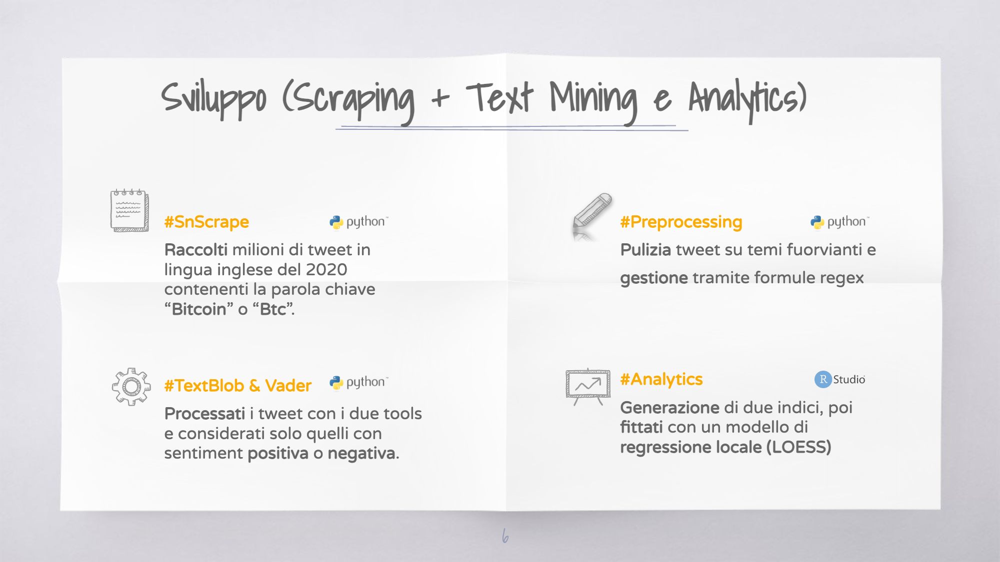
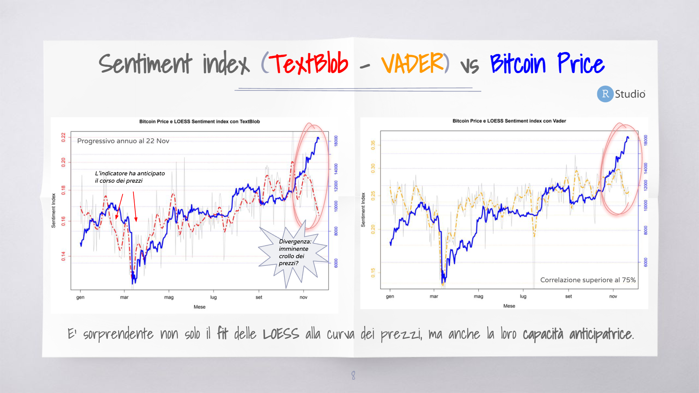
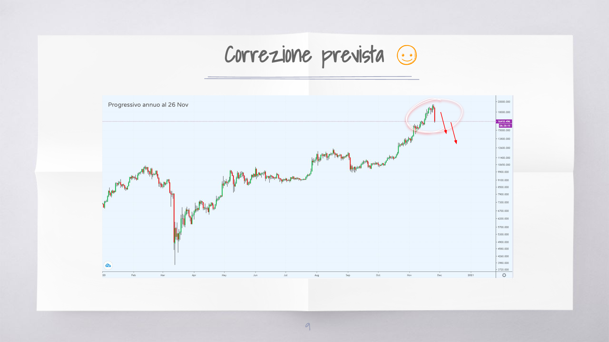
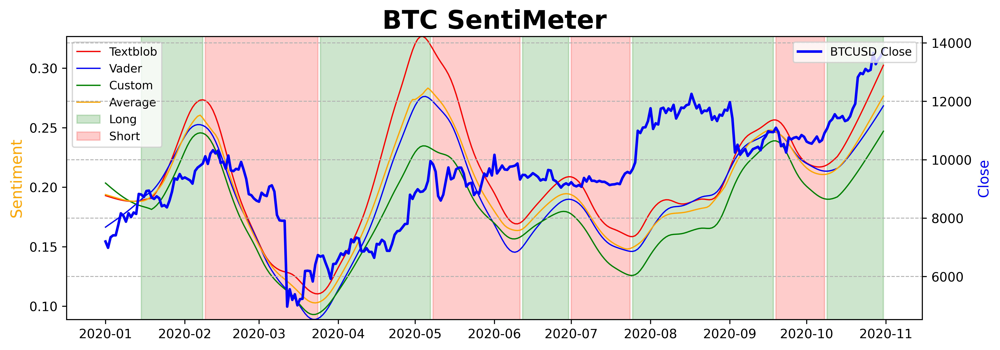

# Bitcoin SentiMeter ₿

**Can the mood on social media be measured, and does it move ahead of Bitcoin's price?**

Slides and figures from a project for the Master in Business Intelligence & Big Data Analytics at the
University of Milano-Bicocca (November 2020), by Daniele Raimondi and Federico Reggiani.

> This repository contains **only the presentation and a few figures**. Code, tweets and any derived
> datasets are not published.

## Approach

1. **Corpus**: public English-language tweets from 2020 mentioning "Bitcoin" or "BTC".
2. **Cleaning**: off-topic and misleading tweets (spam, giveaways, automated price updates) filtered
   out with rule-based patterns.
3. **Scoring**: the polarity of each tweet measured with two lexicon-based tools, TextBlob and VADER;
   only clearly positive or negative tweets kept.
4. **Index**: a daily sentiment index for each tool, smoothed with a local regression (LOESS) and
   compared with Bitcoin's daily close.

## Selected figures

### Sentiment index vs. price
In 2020 the smoothed index followed the price closely, and at times turned before it.

### Divergence in late 2020
In November 2020 sentiment and price diverged; the presentation discusses this as a possible early
warning of a correction.

### SentiMeter
Green and red bands mark the periods in which the smoothed index was rising or falling. It is an
exploratory visualisation, not a trading rule.

📄 [Full slides (PDF)](docs/slides.pdf)

## Disclaimer

- For educational and research purposes only. This is **not financial advice**, and nothing here is a
  recommendation to buy or sell any asset. A relationship observed over a single year of data is not
  evidence that sentiment predicts prices.
- Not affiliated with or endorsed by X Corp. (formerly Twitter). No tweets, usernames or other personal
  data are stored or redistributed in this repository.
- Logos and third-party charts shown in the slides (for example the Kraken Intelligence chart and the
  "Psychology of a Market Cycle" chart by Wall St. Cheat Sheet) belong to their respective owners and
  appear for commentary only. If you hold rights to anything shown here and want it removed, please
  open an issue.

## Credits

- [TextBlob](https://github.com/sloria/TextBlob), by Steven Loria and contributors (MIT licence).
- [VADER](https://github.com/cjhutto/vaderSentiment): C.J. Hutto and E. Gilbert, *VADER: A Parsimonious
  Rule-based Model for Sentiment Analysis of Social Media Text*, ICWSM 2014 (MIT licence).

© 2020 Daniele Raimondi and Federico Reggiani. All rights reserved.
